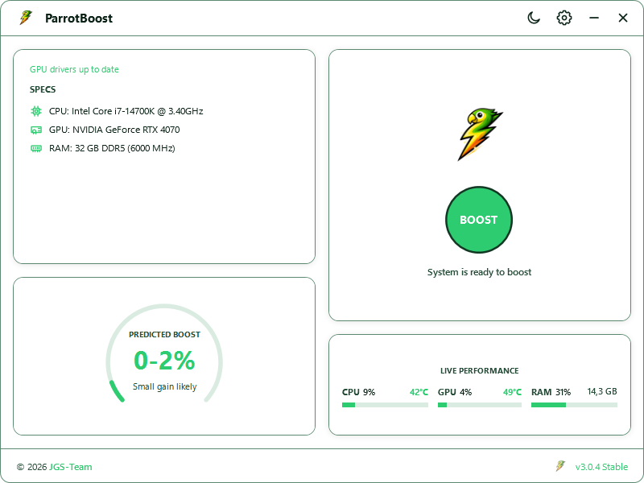
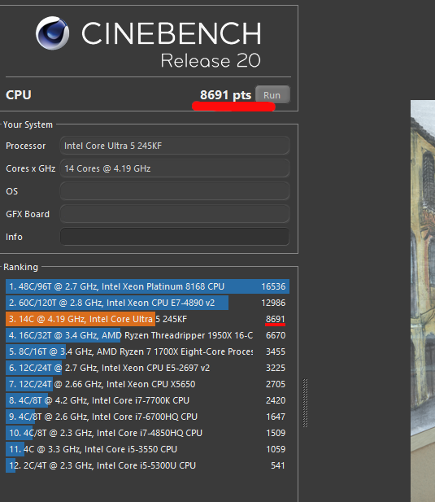
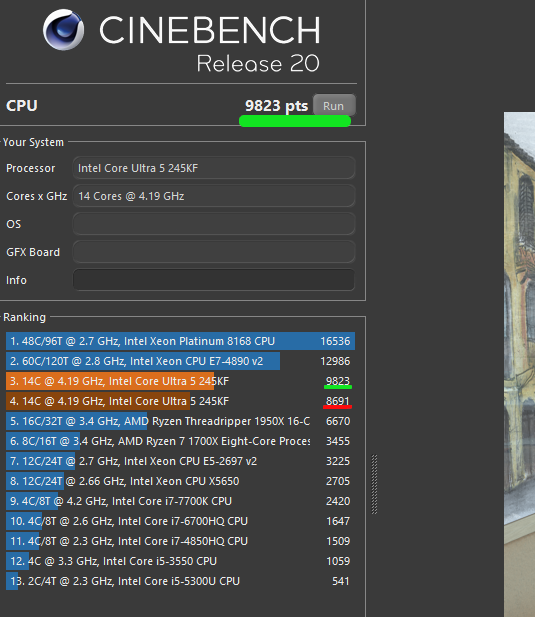

<div align="center">
  

  <br />

  

  <br />

  
  
  
  
</div>

## About ParrotBoost

**ParrotBoost** is a high-precision Windows system and gaming performance optimizer built natively in C# / WPF for **Windows 10 (1809+) and Windows 11 (x64)**. Designed for low overhead, safety, and full reversibility, ParrotBoost pairs real-time hardware telemetry with an integrated latency, standby-RAM, power-plan, privacy, and cleanup engine.

### Key Features (v3.0.4 Stable)

- **Predicted Boost & Zero-Footprint Telemetry:** Live CPU, Multi-GPU / iGPU (hybrid & integrated graphics fallback), RAM, storage, and PnP Device Manager diagnostics powered by Win32 APIs and LibreHardwareMonitor.
- **GPU Driver Update Checker:** Automatically checks for newer NVIDIA Game Ready/DCH, AMD Adrenalin, and Intel Arc/Iris/UHD drivers against vendor endpoints.
- **Integrated ISLC & Process Lasso Engine:** Built-in `NtSetTimerResolution` (0.50 ms HighQoS), standby memory list purging (`SeProfileSingleProcessPrivilege`), P/E-core hybrid topology detection, and adaptive background throttling (ProBalance) with PID+CreateTime safety.
- **CPU & Power (ParkControl + Idle Boost):** Activates the **Turbo Parrot** high-performance power scheme, configures core parking (including Class 1 E-core clusters), min/max frequency ceilings, turbo boost modes, CPU usage limits (5%–100%), and optional automatic idle/battery/fullscreen plan switching.
- **Windows Kernel, Service & Network Tuning:** Non-destructive management of Windows services (with per-service baseline restore), telemetry & maintenance scheduled tasks, Delivery Optimization P2P blocking, dynamic tick (`bcdedit`), `Win32PrioritySeparation`, and Game Mode.
- **Privacy & Microsoft AI Guard (11 Toggles):** Dedicated controls for Advertising ID, Diagnostic Data, Activity History, Location, Feedback, Copilot, Windows Recall, ClickToDo, Generative Search AI, App AI (Paint/Photos), and Edge AI policies.
- **Safe System Cleanup:** Age-filtered (`>15 min`) and symlink/reparse-guarded cleaning for Prefetch (`>14 days`), Temp, Windows Update cache, Recycle Bin, browser caches (Chrome, Edge, Brave, Vivaldi, Opera, Firefox), thumbnails, WER dumps, setup logs, plus on-demand Standby RAM purge.
- **Refreshed Light & Dark Themes + 6 Languages:** High-contrast green-on-white Light theme and Obsidian Dark theme, with live switching across English, Polski, Norsk, Deutsch, 简体中文, and 日本語.
- **Seamless Auto-Updates:** Checks GitHub Releases for newer builds and launches the elevated Inno Setup installer in one click.

## App Preview

<div align="center">
  
  <br />
  <sub><i>ParrotBoost v3.0.4 Stable — Main Dashboard (Light Theme)</i></sub>
</div>

---

## Performance Impact

| Before Optimization | After Optimization |
| :---: | :---: |
|  |  |
| *Default Windows Background Load* | *ParrotBoost Optimization Applied* |

## Installation & Requirements

### Requirements
- **OS:** Windows 10 (64-bit, build 17763+) or Windows 11 (64-bit)
- **Privileges:** Administrator (required for power plans, kernel timers, standby purge, services, and HKLM policies)

### Option 1: Installer (Recommended)
1. Download **`ParrotBoost-Setup-x64.exe`** from [GitHub Releases](https://github.com/JGS-Team/ParrotBoost/releases).
2. Run as Administrator and accept the EULA.
3. Launch ParrotBoost (light theme & English out-of-the-box) and click **BOOST** — all changes can be cleanly reverted anytime via **Slow Down** or **Restore Factory Defaults**.

### Option 2: Portable Executable
Download `ParrotBoost.exe` from Releases and run it from any writable directory. Default configuration templates are stored in `Source/default_settings.json`.

### Built-In Self-Diagnostics
You can run the embedded non-destructive verification suite (17 checks) from an elevated terminal:
```powershell
.\ParrotBoost.exe --self-diagnostics
```

## Building from Source

### Prerequisites
- [.NET 11 SDK](https://dotnet.microsoft.com/) (or matching target SDK in `Source/ParrotBoost/ParrotBoost.csproj`)
- [Inno Setup 6/7](https://jrsoftware.org/isinfo.php) *(optional, only needed to compile the installer)*

### Build Standalone `ParrotBoost.exe`
```powershell
.\DevKit\build.ps1
```

### Build Installer (`Installer\ParrotBoost-Setup-x64.exe`)
```powershell
.\Installer\build_installer.ps1
```

## Security & Trust

- **Local Processing:** Hardware metrics and telemetry stay strictly local and are never sent to JGS-Team or third parties.
- **Reversible Baselines:** Service states, registry values, and power plan GUIDs are captured before modification so **Slow Down** and **Restore Factory Defaults** can restore your system safely.
- **Open Inspection:** Full application source code is available in `Source/ParrotBoost/`.

## License & Legal

- **End User License Agreement:** See [EULA.txt](EULA.txt)
- **Source Code & Third-Party Notices:** See [LICENSE.txt](LICENSE.txt)

## Publisher & Support

Published & maintained by **[JGS-Team](https://github.com/JGS-Team/ParrotBoost)**  
Bug reports & feature requests: [GitHub Issues](https://github.com/JGS-Team/ParrotBoost/issues)
